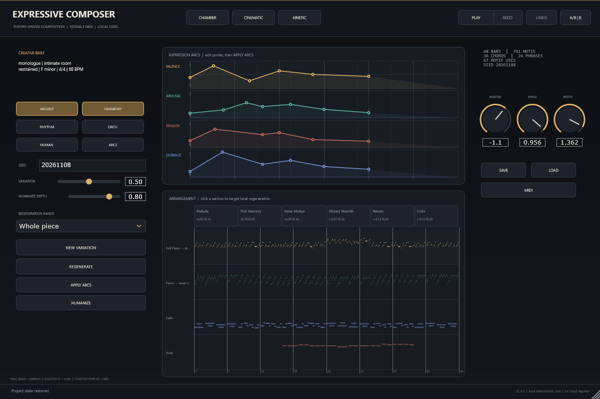

# Expressive Composer

可编辑、可解释、可复现的 AI 辅助音乐创作插件原型。核心不是“生成一段完整音频”，而是生成**有动机、有结构、有呼吸、可继续修改**的 MIDI/工程数据，并用程序化自然感音色试听。



> 版本：0.1.0（P0 垂直切片）  
> 版权：Copyright © 2026 LuoTaiyu，见 [COPYRIGHT.md](COPYRIGHT.md)  
> 许可：AGPL-3.0（JUCE 与 VST3 SDK 双许可，见 [DEPENDENCIES_AND_LICENSES.md](DEPENDENCIES_AND_LICENSES.md)）  
> 用户指南：[USER_GUIDE.md](USER_GUIDE.md)  
> 发布包：[v0.1.0 Windows x64](https://github.com/LuoTaiyu/music_plugin/releases/tag/v0.1.0)  
> 默认平台：Windows x64（本机实际构建/测试）；macOS AU 需在 macOS 上构建，当前未验证。

## 1. 现在真的能做什么

- 三套完整示范工程（不是四小节 loop）：
  - **Chamber** — *Letters in a Quiet Room*：F 小调、4/4、68 BPM、48 小节、约 2:52；
  - **Cinematic** — *Pressure Line*：D 弗里几亚、5/4、92 BPM、44 小节、约 2:26；
  - **Kinetic** — *Kinetic Bloom*：E 多利亚、4/4、122 BPM、36 小节、约 1:14。
- 确定性生成：动机、和声、低音、琶音/pad、对位、打击乐、乐句、段落。
- 每条音轨可编辑；动机出现有 `motifUses` 追踪。
- 四条情绪曲线（valence/arousal/tension/distance）映射到具体音乐参数。
- 乐句级 Humanizer：力度、连断、呼吸、微时序、亮度/噪声/释放联动。
- 锁定维度 + 局部范围重生成；全锁保护；undo/redo；A/B 版本。
- 自然感合成：Felt Piano、Bowed String、Glass Mallet、Organic Bass、Drum Kit。
- 效果链：EQ、压缩、FDN 混响、宽度、软限幅、DC 阻断。
- JSON 工程保存/恢复；SMF MIDI 导入/导出（含 tempo、拍号、段落 marker、note overlap、CC）；WAV 渲染。
- JUCE VST3 + Standalone + 自绘编辑器（曲线、时间线、锁、导出）。
- 测试套件：32 项自动化测试，覆盖乐理、生成、确定性、MIDI 往返、DSP、采样率/缓冲区、WAV。

## 2. 快速开始（Windows）

### 2.1 依赖

- CMake ≥ 3.22
- Ninja（推荐）
- Visual Studio 2022 Build Tools，含 “使用 C++ 的桌面开发”
- JUCE 8.0.6（仓库 `third_party/JUCE` 已放置；也可运行 `scripts/fetch_dependencies.ps1` 重新下载）
- 无需 Python、无需网络、无需采样库

> **路径注意**：JUCE 的 `juceaide` 在中文路径下会错误编码路径。`scripts/build.ps1` 会自动创建 `D:\ecwork` 目录联接（junction）并在 ASCII 路径下构建；源码仍在原目录。
> 如果手动构建插件，请把工程放到纯 ASCII 路径，或先创建 junction 再从那里配置 CMake。

### 2.2 一键构建（推荐）

```powershell
powershell -ExecutionPolicy Bypass -File scripts/build.ps1 -Target all -Configuration Release
```

产物：

- 核心测试/CLI：`build-core/ec_cli.exe`、`build-core/ec_tests.exe`
- 插件：`build-plugin-ascii/...`（脚本结束会打印实际路径）
- Standalone：`build-plugin-ascii/src/plugin/ExpressiveComposer_artefacts/Release/Standalone/Expressive Composer.exe`
- VST3：`build-plugin-ascii/src/plugin/ExpressiveComposer_artefacts/Release/VST3/Expressive Composer.vst3`

把 `.vst3` 复制到 `C:\Program Files\Common Files\VST3\`（或 DAW 的 VST3 路径），在 DAW 中扫描；Standalone 可直接双击运行。

### 2.3 手动构建核心（不需要 JUCE）

```powershell
cmake -S . -B build-core -G Ninja -DCMAKE_BUILD_TYPE=Release `
  -DEC_BUILD_PLUGIN=OFF -DEC_BUILD_TESTS=ON -DEC_BUILD_BENCH=ON
cmake --build build-core --parallel
.\build-core\ec_tests.exe
```

### 2.4 手动构建插件

```powershell
# 在 ASCII 路径下（例如 junction D:\ecwork）：
cmake -S D:\ecwork -B D:\ecwork\build-plugin -G Ninja -DCMAKE_BUILD_TYPE=Release `
  -DEC_BUILD_PLUGIN=ON -DEC_BUILD_CLAP=OFF -DEC_BUILD_TESTS=OFF
cmake --build D:\ecwork\build-plugin --parallel 4
```

如果没有 Visual Studio 环境，先在 “x64 Native Tools Command Prompt for VS 2022” 中运行，或使用 `scripts/build.ps1`（它会调用 `VsDevCmd.bat`）。

## 3. 立即试用（CLI）

仓库同时提供预构建工具（来自本机 Release 构建，验证 32/32 测试通过）：

```powershell
.\dist\tools\ec_cli.exe demos
.\dist\tools\ec_tests.exe
```

如果你要自己构建，再用下面的 `build-core\ec_cli.exe` 路径。


```powershell
# 生成三套示范：project.json + .mid + .wav + report.txt
.\build-core\ec_cli.exe generate --demo all --seed 20261108 --out presets/demos

# 只生成 Kinetic，不渲染 WAV
.\build-core\ec_cli.exe generate --demo kinetic --no-wav --out presets/demos

# 查看工程结构
.\build-core\ec_cli.exe inspect presets/demos/chamber/project.json

# 渲染已有工程
.\build-core\ec_cli.exe render presets/demos/chamber/project.json `
  --wav presets/demos/chamber/chamber.wav --sr 44100 --bits 24

# 导出 MIDI
.\build-core\ec_cli.exe export-midi presets/demos/chamber/project.json `
  --out presets/demos/chamber/chamber.mid

# MIDI 回导（默认优先使用 ECP1 工程负载；--standard 强制按标准 MIDI 解析）
.\build-core\ec_cli.exe import-midi presets/demos/chamber/chamber.mid `
  --out build-core/imported.json
.\build-core\ec_cli.exe import-midi presets/demos/chamber/chamber.mid `
  --out build-core/imported-standard.json --standard

# 真实性能基准（本机实测，不虚构）
.\build-core\ec_cli.exe bench --iterations 5
```

## 4. 插件工作流

1. 在 DAW 中插入 **Expressive Composer**（Instrument）。
2. 选 **CHAMBER / CINEMATIC / KINETIC** 生成一个完整方案。
3. 拖动四条情绪曲线；按 **APPLY ARCS** 用新曲线重新作曲。
4. 在 **ARRANGEMENT** 点击段落，选择局部范围。
5. 设置 **LOCKS**（Melody/Harmony/Rhythm/Orch./Human./Arcs），按 **REGENERATE**。
6. **PLAY** 是内部试听；宿主播放时以宿主 PPQ/BPM 为准。
7. **SAVE/LOAD** 保存/加载 `.json` 工程；**MIDI** 导出 `.mid`。
8. **A/B** 比较两个版本；**UNDO/REDO** 回退。

详细说明：`USER_GUIDE.md`。

## 5. 验证状态（诚实报告）

| 项目 | 状态 |
|---|---|
| 核心 + CLI + 测试构建 | Windows x64 实际构建通过（见 `BUILD_REPORT.md`） |
| JUCE VST3/Standalone 构建 | 见 `BUILD_REPORT.md` 的实际结果 |
| AU | 未在 macOS 构建/验证 |
| CLAP | 未构建（子模块未初始化；CMake 开关保留） |
| 真实 DAW 兼容性 | **未验证**；没有安装/扫描真实 DAW |
| 人工听音/盲测 | **未进行**；不声称“听感已验证” |
| `tools.zip` 审计 | **未提供**；见 `MATERIALS_AUDIT.md` |
| 性能数字 | 本机实测，不等同于其他机器 |

## 6. 目录

```
src/core/        数据模型、表达映射、乐理、动机、作曲、Humanizer、序列化
src/dsp/         合成器、效果、总线保护
src/io/          SMF MIDI、WAV
src/render/      离线渲染
src/plugin/      JUCE VST3/Standalone + 编辑器
src/cli/         无 DAW 入口
tests/           自动化测试与基准
docs/            架构、理论、评价、用户指南、材料审计、构建报告
presets/demos/   生成的示范工程（运行 CLI 后出现）
scripts/         构建与依赖脚本
third_party/     JUCE 8.0.6（AGPL/商业双许可）
```

## 7. 重要限制

1. 插件**不向宿主输出 MIDI**；MIDI 通过导出文件交付。
2. 单插件**不能读取 DAW 全部轨道**，不做全局母带/跨轨分析。
3. 和弦没有局部锁定；局部重生成的 chords 仍可能来自整曲候选。
4. 音色是程序化合成，不是采样库；未做听感验证。
5. 没有云模型/本地大模型；P0 完全离线。
6. UI 的 WAV 导出未接线（`exportWavFile` API 存在）；请用 CLI。
7. 中文路径构建插件需要 junction；脚本已处理，手动构建需注意。
8. 音频导出/FX 参数与真实 DAW 的兼容性仍需在真实宿主中验证。

## 8. 文档

- [ARCHITECTURE.md](docs/ARCHITECTURE.md) — 模块、线程、数据流、扩展接口
- [THEORY_AND_PSYCHOLOGY.md](docs/THEORY_AND_PSYCHOLOGY.md) — 理论依据、证据边界、真实文献
- [ARTISTIC_EVALUATION.md](ARTISTIC_EVALUATION.md) — 评价表、示范分析、未解决问题
- [USER_GUIDE.md](USER_GUIDE.md) — 从情绪设想到 DAW 导出
- [MATERIALS_AUDIT.md](docs/MATERIALS_AUDIT.md) — 材料审计（含缺失的 tools.zip）
- [DEPENDENCIES_AND_LICENSES.md](DEPENDENCIES_AND_LICENSES.md)
- [ROADMAP.md](ROADMAP.md) — P0/P1/P2 实际状态
- [BUILD_REPORT.md](BUILD_REPORT.md) — 真实构建、测试、性能结果
- [OBJECTIVE_AUDIO_ANALYSIS.md](docs/OBJECTIVE_AUDIO_ANALYSIS.md) — WAV 的客观测量（非听感）
- [PHASE_LOG.md](docs/PHASE_LOG.md) — 按阶段记录实际完成内容、修改、构建/测试结果与限制

## 9. 许可

本仓库以 **AGPL-3.0** 发布。JUCE 采用 AGPLv3/商业双许可；闭源商业分发必须购买 JUCE 商业许可并遵守 VST3 SDK 条款。详见 `DEPENDENCIES_AND_LICENSES.md`。
